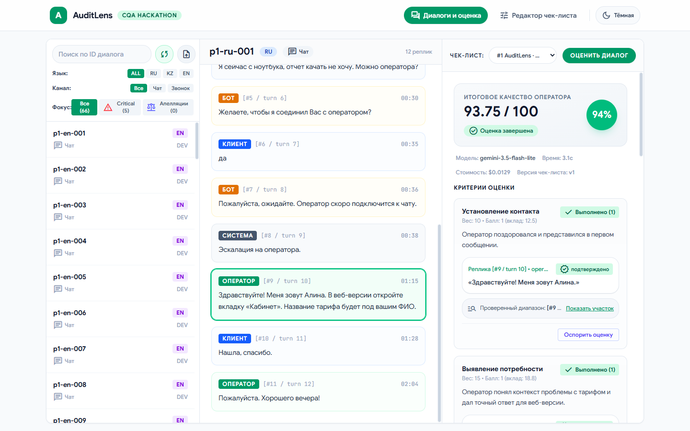
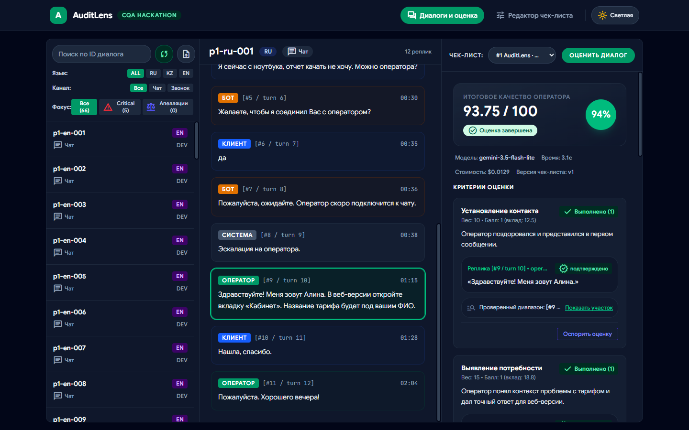
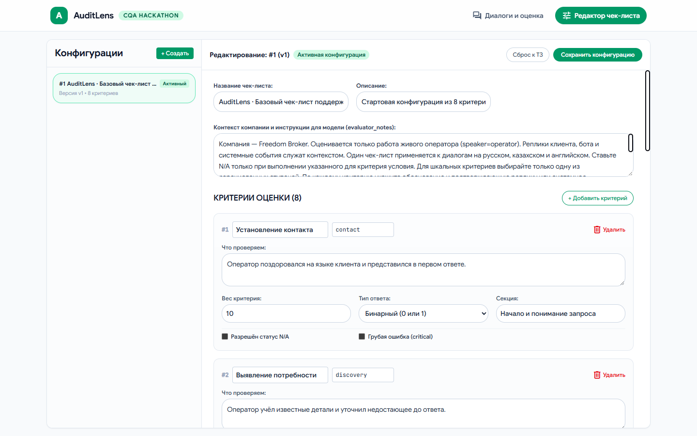
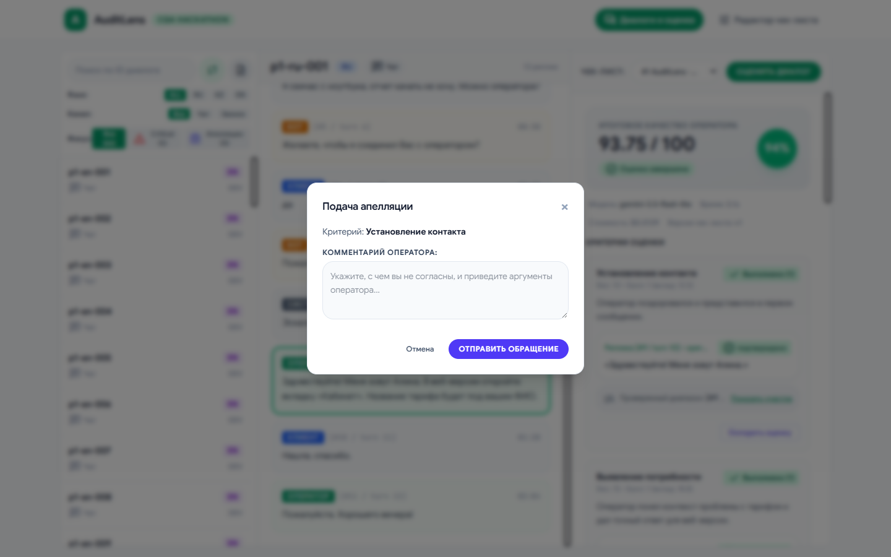
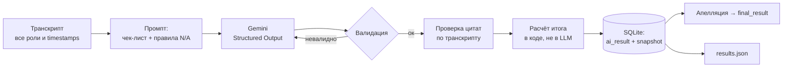
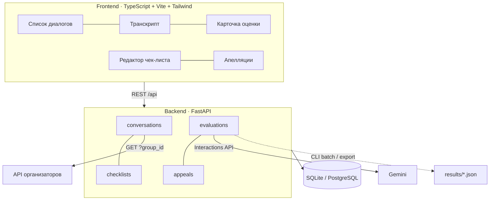

<div align="center">

# 🔍 AuditLens

**AI-оценка качества работы операторов поддержки — с доказательствами, апелляциями и пересчётом итога**

Решение для **Freedom Broker · CQA Hackathon** (Conversation Quality Analytics)




</div>

---

## Содержание

- [Что умеет](#-что-умеет)
- [Быстрый старт](#-быстрый-старт)
- [Сценарий демонстрации](#-сценарий-демонстрации-5-минут)
- [Как устроена оценка](#-как-устроена-оценка)
- [Результаты на DEV](#-результаты-на-dev)
- [Модель и стоимость](#-модель-и-стоимость)
- [Архитектура](#-архитектура)
- [Настройки](#-настройки-env)
- [Сдача результатов](#-сдача-результатов)
- [Структура проекта](#-структура-проекта)
- [Ограничения](#-известные-ограничения)

---

## ✨ Что умеет

| Контур 1 · Оценка | Контур 2 · Работа с результатом |
| --- | --- |
| 📥 Загрузка набора по `group_id` из API организаторов или импорт JSON | 🗂 Список диалогов с фильтрами по языку, каналу, critical и апелляциям |
| 🛠 Редактор чек-листа: критерии, веса, шкалы, N/A, грубые ошибки, версии | 🎯 Клик по доказательству прокручивает транскрипт к нужной реплике |
| 🤖 Оценка оператора по чек-листу через Gemini (RU · KZ · EN, чаты и звонки) | 🎧 Плеер записи для звонков |
| 📑 По каждому критерию: значение, вес, вклад, обоснование, цитата | ⚖️ Апелляция по критерию с комментарием |
| ➗ Детерминированный расчёт итога с перераспределением веса N/A | ✅ Решение проверяющего (подтвердить / изменить) с обязательной причиной |
| 🚩 Грубая ошибка — отдельный флаг, итог не обнуляется | 🔁 Исходная AI-оценка, решение и финальный балл видны рядом |

Реплики бота и системные события служат контекстом: оценивается **только оператор**.

---

## 🚀 Быстрый старт

### Вариант A — Docker (рекомендуется)

```bash
cp .env.example .env          # впишите GEMINI_API_KEY
docker compose up -d --build
```

Откройте **http://localhost:8000** · Swagger: http://localhost:8000/api/docs · Health: http://localhost:8000/api/health

При старте контейнер сам применяет миграции и создаёт стартовый чек-лист из 8 критериев ТЗ.
База SQLite хранится в `backend/data/` (том), поэтому данные переживают перезапуск.

### Вариант B — локально

Нужны Node.js 20.19+, Python 3.11+ (рекомендуется `uv`).

```bash
npm run setup     # venv, зависимости, .env, миграции, чек-лист, пакеты фронтенда
npm run dev       # backend :8000 + frontend :5173
```

### Загрузить DEV-набор

- **Через UI:** кнопка импорта файла → `docs/invoke.json` (65 диалогов).
- **Через API организаторов:** задайте `DATASET_API_URL` в `.env` и нажмите синхронизацию.

> [!IMPORTANT]
> Без `GEMINI_API_KEY` приложение работает в режиме **mock** — это заглушка для разработки
> интерфейса, такие оценки помечаются в карточке и **не допускаются** к официальному экспорту.

---

## 🎬 Сценарий демонстрации (5 минут)

| Время | Шаг | Где в интерфейсе |
| --- | --- | --- |
| 1 мин | Интерфейс, набор, выбранный диалог | «Диалоги и оценка» → фильтры → диалог |
| 2 мин | Оценка, обоснование, переход к реплике, пример N/A, итог | «Оценить диалог» → карточка критерия → цитата |
| 1 мин | Апелляция, решение проверяющего, новый итог | «Оспорить оценку» → решение с причиной |
| 1 мин | Изменение критерия и применение чек-листа | «Редактор чек-листа» → сохранить → оценить диалог |

<details>
<summary>📸 Скриншоты (тёмная тема, редактор чек-листа, апелляция)</summary>







</details>

---

## 🧠 Как устроена оценка



**Модель только выставляет значения по критериям — вся математика в коде** (`scoring.py`):

$$
\text{итог} = \sum_{i \in \text{применимые}} \frac{\text{значение}_i}{\text{максимум}_i} \cdot \frac{\text{вес}_i}{\sum \text{вес}_\text{применимых}} \cdot 100
$$

- **N/A** исключает критерий и пропорционально перераспределяет его вес; это не ноль и не ошибка.
- Округление — `half_up` до 2 знаков, как в чек-листе организаторов.
- **Валидация ответа AI:** все критерии ровно один раз, допустимые ступени шкалы, N/A только там, где он разрешён, согласованность `critical`. После двух невалидных ответов оценка получает `failed`, а не нулевой балл.
- **Доказательства:** цитата сверяется с транскриптом дословно (`verified`); для пропущенного действия указывается проверенный участок `checked_range`.
- **Версии:** каждая оценка хранит снимок чек-листа, поэтому правка критериев не меняет прошлые оценки.
- **Звонки:** оценивается выданный транскрипт; дикция и интонация по тексту не выводятся.

<details>
<summary>📋 Стартовый чек-лист (8 критериев)</summary>

| ID | Критерий | Значения | Вес | N/A |
| --- | --- | --- | ---: | --- |
| `contact` | Установление контакта | да / нет | 10 | — |
| `discovery` | Выявление потребности | да / нет / N/A | 15 | данных хватало сразу |
| `identification` | Идентификация | да / нет / N/A | 20 | не требовалась |
| `consultation` | Корректность и полнота | 0 · 5 · 10 · 15 · 20 / N/A | 20 | запрос не сформулирован |
| `empathy` | Эмпатия | да / нет | 15 | — |
| `dialogue` | Ведение, скорость, грамотность | 0 · 4 · 7 · 10 | 15 | — |
| `closure` | Завершение | да / нет / N/A | 5 | чат оборвался |
| `critical` | Грубые ошибки | да / нет | 0 | — (отдельный флаг) |

</details>

---

## 📊 Результаты на DEV

Файл сдачи: [`results/dev/results.json`](results/dev/results.json) — формат JSON 1.0 организаторов.

| Показатель | Значение |
| --- | --- |
| Диалогов | **65** (60 чатов + 5 звонков · 35 RU / 15 KZ / 15 EN) |
| Статус | **65 `ok`** · 0 `error` |
| Итоговый балл | min 10.0 · среднее 86.15 · max 100.0 |
| Выявлено грубых ошибок | 5 |
| Средняя задержка оценки | ≈ 6.9 с |

> [!NOTE]
> Это результаты одного прогона модели, а не проверенная разметка. Независимая ручная
> сверка качества по критериям ещё не проводилась; повторная оценка одного и того же
> диалога может отличаться.

---

## 💰 Модель и стоимость

- **Модель:** `gemini-3.5-flash-lite` (Google Gemini API, режим `external_api`).
- **Вызовов на оценку:** 1, плюс 1 повтор, если ответ не прошёл валидацию.
- **Токены на оценку (DEV, среднее):** ≈ 2 960 входных · 1 110 выходных · 240 thinking.
- **Расчётная стоимость одной оценки:** **≈ \$0.015** при тарифах из `.env`
  (`LLM_PRICE_INPUT_PER_1M=1.50`, `LLM_PRICE_OUTPUT_PER_1M=7.50`); весь DEV ≈ \$0.95.

> [!WARNING]
> Стоимость **расчётная**: она считается по тарифам из `.env` с учётом всех попыток, а не по
> счёту провайдера. Тарифы для `gemini-3.5-flash-lite` нужно сверить с
> [официальным прайсом](https://ai.google.dev/pricing) и обновить в `.env`. На бесплатном
> ключе фактическая оплата отсутствует.

---

## 🏗 Архитектура



- **Интерфейс** — чистые HTML, CSS и TypeScript без фреймворка, собирается в статический бандл.
  Это упрощает будущую адаптацию в HTML-компонент Dynamics 365.
- **Один процесс:** в продакшен-режиме FastAPI раздаёт и API, и собранный фронтенд.
- **Без авторизации** — по условию ТЗ; подача и рассмотрение апелляции разделены в интерфейсе.

---

## ⚙️ Настройки (`.env`)

Полный список с комментариями — в [`.env.example`](.env.example). **Никогда не коммитьте `.env`.**

| Переменная | По умолчанию | Назначение |
| --- | --- | --- |
| `GEMINI_API_KEY` | — | Ключ Gemini. Пусто → mock-режим |
| `GEMINI_MODEL` | `gemini-3.5-flash-lite` | ID модели |
| `GEMINI_THINKING_LEVEL` | `medium` | `minimal` · `low` · `medium` · `high` |
| `LLM_TIMEOUT_SECONDS` | `120` | Общий бюджет времени на одну оценку, включая повторы |
| `LLM_MAX_RETRIES` | `3` | Транспортные попытки внутри бюджета |
| `LLM_BATCH_CONCURRENCY` | `4` | Параллельных оценок; на Free Tier ставьте `1` |
| `LLM_PRICE_INPUT_PER_1M` / `_OUTPUT_` | `1.50` / `7.50` | Тарифы для расчётной стоимости |
| `DATASET_API_URL` | — | GET-ссылка организаторов; меняется только `group_id` |

---

## 📦 Сдача результатов

```bash
# 1. оценить набор (новая папка на каждый запуск)
node scripts/py.mjs -m app.features.evaluations.batch --group DEV --checklist 1 --output-dir data/exports/dev-run

# 2. проверить и записать results/dev/results.json (ровно 65 записей)
node scripts/py.mjs -m app.features.evaluations.export --kind dev --group DEV \
  --dataset ../docs/invoke.json --evaluation-ids data/exports/dev-run/evaluation-ids.json \
  --checklist-id 1 --checklist-version 1 --source ai --team "AuditLens" --model-mode external_api
```

Экспортёр не вызывает модель: он сверяет ID с исходным набором, типы, ступени, индексы
`evidence_turns` (с 1, по полному транскрипту), математику итога и `critical_flag`, и пишет
файл атомарно. Неудачные оценки попадают в файл как `status: "error"`, а не как ноль.

📘 Контрольный набор, лимиты Free Tier, досчёт ошибок и детали CLI — в **[docs/RUNBOOK.md](docs/RUNBOOK.md)**.

---

## 🗂 Структура проекта

```text
AuditLens/
├── backend/
│   ├── app/
│   │   ├── core/                 # настройки, БД, ошибки
│   │   └── features/
│   │       ├── conversations/    # импорт и синхронизация наборов
│   │       ├── checklists/       # чек-листы и версии
│   │       ├── evaluations/      # промпт, Gemini, валидация, расчёт, batch, export
│   │       └── appeals/          # апелляции и пересмотр
│   ├── migrations/               # Alembic
│   ├── scripts/                  # проверка Gemini, досчёт DEV
│   └── tests/                    # pytest, без платных вызовов
├── frontend/src/features/cqa/    # интерфейс CQA
├── docs/                         # ТЗ организаторов, DEV-набор, RUNBOOK, скриншоты
├── results/dev/results.json      # файл сдачи DEV
├── Dockerfile · docker-compose.yml
└── .env.example
```

### Команды

```bash
npm run test        # backend-тесты (193, без AI-вызовов)
npm run lint        # Ruff + проверка типов фронтенда
npm run test:gemini # 2 реальных вызова Gemini для проверки ключа
npm run build       # сборка фронтенда
```

---

## ⚠️ Известные ограничения

- Качество модели на DEV не сверено с независимой ручной разметкой; результаты — вывод модели.
- Прогресс batch хранится в памяти процесса; готовые оценки сохраняются в БД и переживают перезапуск.
- Звонки оцениваются по текстовому транскрипту; аудио не анализируется.
- Стоимость в интерфейсе и отчётах расчётная.

---

<div align="center">

Сделано командой **AuditLens** для Freedom Broker · CQA Hackathon

</div>
